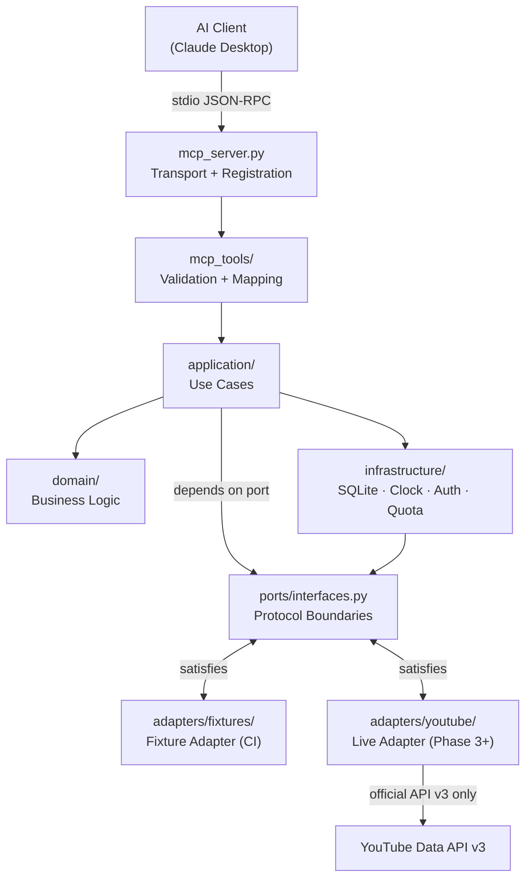

# Cerebra Architecture

**Version:** 1.0  
**Date:** 2026-11-09

---

## Overview

Cerebra is a **modular monolith** Python MCP server implementing YouTube Video Intelligence. It runs locally on the user's machine, communicates with AI clients (e.g. Claude Desktop) via stdio MCP transport, and calls the YouTube Data API v3 on the user's behalf.



---

## Layer Responsibilities

| Layer | Path | Responsibility |
|-------|------|---------------|
| Transport | `mcp_server.py` | MCP protocol, tool registration, stdio |
| Validation | `mcp_tools/validation.py` | Input sanitisation, schema enforcement |
| Use Cases | `application/` | Orchestrate domain + ports; enforce business rules |
| Domain | `domain/` | Pure logic: scoring, solver, state machine, errors |
| Ports | `ports/interfaces.py` | Protocol (ISP) dependency boundaries |
| Adapters | `adapters/` | Fixture (CI) and live (YouTube) implementations |
| Infrastructure | `infrastructure/` | SQLite, Clock, composition root |

---

## Key Design Principles

- **DIP**: Use cases depend on `ports/interfaces.py` Protocols, never on concrete adapters
- **ISP**: Narrow port interfaces (`PublicVideoReader`, `UserLibraryReader`, `PlaylistWriter`) — use cases import only what they need
- **SRP**: `mcp_server.py` does only transport; domain is pure; adapters do only I/O
- **No global singletons**: All state constructed once at `infrastructure/composition.py` and injected
- **Thread safety**: `threading.Lock` on `QuotaLedger` and `SQLiteDB`; no shared mutable module-level state

---

## Data Flow: find_similar_videos

```
User: "find videos similar to youtube.com/watch?v=dQw4w9WgXcQ"
  → AI client calls find_similar_videos(reference="...", limit=10)
  → mcp_server.py: call_tool("find_similar_videos", args)
  → validation.py: validate_reference(args["reference"])  → "dQw4w9WgXcQ"
  → FindSimilarUseCase.find_similar_videos("dQw4w9WgXcQ", 10)
    → quota.reserve(QuotaEstimate(general=11))  # 1 seed + 10 candidates
    → video_reader.get_video("dQw4w9WgXcQ")  → VideoMetadata
    → video_reader.get_videos_by_category(category_id, limit=50)  → list[VideoMetadata]
    → scoring.rank_videos(seed, candidates)  → list[RankedVideo]
    → return top 10
  → mcp_server.py: format as TextContent JSON
  → AI client: presents ranked list to user
```

---

## Approval Flow: propose + create playlist

```
1. propose_playlist(topic, total_duration_seconds)
   → ProposePlaylistUseCase:
     → quota.reserve(write_estimate)
     → playlist_solver.solve(candidates, constraints) → PlaylistProposal
     → compute digest = SHA-256(proposal_id + topic + video_ids + expiry + account)
     → proposal_store.save(proposal)  [state=PROPOSED]
     → return {proposal_id, confirmation_digest, videos, expires_at}

2. Human reviews the video list and copies confirmation_digest

3. create_playlist(proposal_id, confirmation_digest)
   → CreatePlaylistUseCase:
     → proposal_store.get(proposal_id)  [must be PROPOSED, not expired]
     → verify digest (hmac.compare_digest)
     → state_machine.transition(PROPOSED → CONFIRMED)  [SQLite, atomic]
     → state_machine.transition(CONFIRMED → PARTIAL)   [SQLite, before first write]
     → playlist_writer.create_playlist(title, description, privacy)  → playlist_id
     → store playlist_id  [SQLite, atomic]
     → for each video: playlist_writer.add_item(playlist_id, video_id)
     → state_machine.transition(PARTIAL → CREATED)
     → audit_log.record(event="PLAYLIST_CREATED", ...)
```

---

## Security Boundaries

| Boundary | Protection |
|----------|-----------|
| MCP input | `mcp_tools/validation.py`: type, length, pattern, path-traversal |
| Video metadata in output | `[DATA]` prefix on all untrusted strings (FR-4.10) |
| Write approval | Digest + proposal_id + expiry + single-use (ADR-A) |
| Token storage | OS keyring or owner-only file (ADR-D) |
| CI isolation | Fixture adapter; zero live API calls in CI (NFR-TE-1) |
| Quota guard | Upfront reservation; refuse before first call (FR-5.8) |
